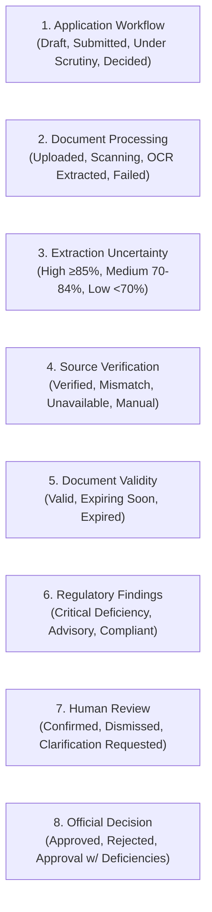

# NIYAM — UI/UX Design System Specification
**Problem Statement ID:** 26261 | **AICTE Regulation Bureau Prototype**  
**Working Title:** Niyam — Institutional Application Review Platform  
**Target Compliance:** WCAG 2.2 Level AA Standard | Public-Sector Enterprise Grade

---

## 1. Product Purpose & Design Philosophy

Technical institutions submit applications for Extension of Approval (EoA), Increase in Intake, Establishment of New Institutions, and Course Variations. Regulatory officials must examine institutional records, supporting evidence, authenticity, validity, and compliance with statutory handbook norms.

**Niyam** is an integrated decision-support workspace that extracts information from documents, checks completeness and validity, identifies inconsistencies, facilitates authorized source verification, and presents evidence to officials.

### The Statutory Scrutiny Mandate
> [!IMPORTANT]
> **Advisory Boundary Principle:**  
> Artificial intelligence algorithms, layout parsers, OCR heuristics, and external registry adapters provide **strictly advisory findings**. Competent statutory authorities (Scrutiny Officers, Hearing Committees, and Council Authorities) retain the statutory scrutiny mandate, physical inspection discretion, and final regulatory approval decisions. The platform never claims 100% forgery detection, extraction accuracy, or legal endorsement.

---

## 2. Design Tokens

The interface is designed for hours of focused, error-free administrative review. It employs a restrained, trustworthy color palette with calm contrast and high legibility.

### 2.1 Color Palette Tokens

| Token Name | Hex Code | Role & Usage |
| :--- | :--- | :--- |
| `--background` | `#F8FAFC` | Calm, softly tinted page canvas (Slate 50) |
| `--surface` | `#FFFFFF` | Primary content panels, cards, and modal dialogs |
| `--text-primary` | `#17212B` | Deep navy-slate for headings, body copy, and primary values |
| `--text-secondary`| `#526170` | Neutral slate for captions, metadata, labels, and table headers |
| `--border` | `#DCE3E9` | Crisp, low-contrast section dividers and card outlines |
| `--border-strong` | `#CBD5E1` | Input borders, active table headers, and focused panels |
| `--accent` | `#167D8D` | Deep cyan-teal primary interaction accent (buttons, active pills, links) |
| `--accent-hover` | `#11626F` | Darkened teal for hover states |
| `--accent-active`| `#0D4D57` | Deep pressed state |
| `--accent-light` | `#E8F4F6` | Soft teal tint for selected cards, badges, and bounding box fills |
| `--accent-muted` | `#C6E4E8` | Border outline for accent elements |

### 2.2 Semantic Colors (WCAG 2.2 AA Contrast Certified)

All semantic colors are paired with explicit icons, text prefixes, and border styling to avoid relying solely on color.

| Semantic State | Text Hex | Background Hex | Border Hex | Meaning in Context |
| :--- | :--- | :--- | :--- | :--- |
| **Success** | `#0E7052` | `#EBF7F2` | `#A3E0C8` | Verified authenticity, compliant norm, resolved query |
| **Warning** | `#A25807` | `#FFF8EC` | `#FCDCA6` | Expiring document, review advised, 70-85% OCR confidence |
| **Error / Critical** | `#B42318` | `#FEF3F2` | `#FECDCA` | Critical deficiency, statutory breach, cross-doc mismatch |
| **Information** | `#026AA2` | `#F0F9FF` | `#B9E6FE` | Advisory note, regulatory handbook clause citation |
| **Outage / Unavailable** | `#92400E` | `#FEF3C7` | `#F59E0B` | External source timeout; **never** treated as an adverse check |

---

## 3. Typography & Spacing Scale

### 3.1 Typography Scale (Geist & Geist Mono)

- **Primary Interface Font:** `Geist`, `-apple-system`, `BlinkMacSystemFont`, `"Segoe UI"`, `sans-serif`
- **Monospace Font:** `Geist Mono`, `ui-monospace`, `SFMono-Regular`, `Consolas`, `monospace` (used for Application Numbers, Document Hashes, GPS Coordinates, Clause Citations, and Dates)

```text
Display Headings:     30px - 36px  (font-bold, tracking-tight, line-height 40px)
Page Headings:        28px - 32px  (font-bold, tracking-tight, line-height 36px)
Card / Sub-headings:  18px - 20px  (font-semibold, line-height 28px)
Primary Body Copy:    16px         (font-normal, line-height 24px)
Secondary Metadata:   14px         (font-normal / font-medium, line-height 20px)
Captions & Badges:    12px         (font-semibold, line-height 16px)
Micro Identifiers:    10px - 11px  (font-mono font-medium)
```

### 3.2 Spacing Scale

Strict 4px/8px incremental rhythm matching cognitive layout scanning:
- `4px` (`gap-1`, `p-1`): Tag paddings, micro-spacers
- `8px` (`gap-2`, `p-2`): Field groups, badge padding, compact icon gaps
- `12px` (`gap-3`, `p-3`): Form input padding, table cell internal spacing
- `16px` (`gap-4`, `p-4`): Card internal padding, form row spacing
- `24px` (`gap-6`, `p-6`): Major card padding, grid gutters
- `32px` (`gap-8`, `p-8`): Section dividers, dialog padding
- `48px` (`gap-12`, `p-12`): Page section gaps

### 3.3 Touch Targets & Focus States

- **Interactive Target Baseline:** All interactive controls (buttons, select inputs, dropdown toggles) enforce a minimum touch target of **44px $\times$ 44px** (`min-h-[44px]`).
- **Focus Rings:** Visible, accessible keyboard focus rings on all interactive elements:
  ```css
  :focus-visible {
    outline: 2px solid #167D8D;
    outline-offset: 2px;
  }
  ```
- **Motion & Reduced Motion:** All subtle transitions (opacity, background) default to `150ms-200ms ease-in-out`. When `@media (prefers-reduced-motion: reduce)` is detected, all transitions and animations are collapsed to `0.01ms`.

---

## 4. Multi-Dimensional Status Architecture

In technical education scrutiny, an application does not have a single binary "status". To avoid ambiguous representations, Niyam displays **8 independent status dimensions**:



### 4.1 Dimension Distinctions

1. **Application Workflow:** Stage in the institutional approval lifecycle.
2. **Document Processing:** Technical state of file parsing, SHA-256 virus scanning, and layout extraction.
3. **Extraction Uncertainty:** Confidence score produced by OCR layout heuristics.
4. **Source Verification:** Result from third-party authoritative issuing bodies.
   - **Verified:** Authoritative match confirmed via DigiLocker, Revenue Portal, or Affiliating University.
   - **Mismatch Detected:** Cross-checked values differ (e.g. Society name differs on land deed vs registration).
   - **Pending:** Verification job dispatched to background worker.
   - **Source Unavailable:** Issuing agency API timed out. **Must never look like a failed authenticity check.**
   - **Manual Review Required:** Officer confirmation needed due to non-standard format or physical register.
   - **Not Checked:** No automated source integration configured for this document type.
5. **Document Validity & Expiry:** Chronological validity of safety or lease records (e.g. Fire NOC expired on 2024-03-31). *A verified document from DigiLocker can still be expired.*
6. **Regulatory Findings:** Deterministic rule engine evaluation against AICTE Approval Process Handbook (APH) clauses.
7. **Human Review:** Scrutiny Officer disposition (Confirmed, Dismissed, or Waived).
8. **Official Decision:** Final statutory order executed by the Competent Authority.

---

## 5. Interaction States & Explanatory Deficiency Design

### 5.1 The 14 Standard Interaction States

Across every screen, Niyam provides explicit visual designs for 14 interaction states implemented in [`StateFeedback.tsx`](file:///d:/SIH%20(project%20chaos)/New%20folder/frontend/src/components/ui/StateFeedback.tsx):

1. **Initial Empty State:** Illustrated container with explicit onboarding prompt and action trigger.
2. **Populated State:** Structured data tables and evidence split views with high information density.
3. **Loading & Processing State:** Accessible animated spinner with explanatory processing step text.
4. **Success State:** Verified badge, green-emerald banner, and audit hash reference.
5. **Validation Error State:** Crimson banner with bulleted list of failing clauses.
6. **Failed Upload State:** File transmission error notice with retry trigger and max size reminder (25 MB).
7. **Unreadable Document State:** Warning flag indicating skewed image, low DPI (< 150), or corrupt digital layer.
8. **Low-Confidence Extraction State:** Amber indicator with direct trigger to Human-in-the-Loop correction modal.
9. **Unavailable External Service State:** Prominent amber notice clarifying technical outage without adverse prejudice.
10. **Permission Denied State:** Zero-trust barrier notice explaining role boundary and assignment constraints.
11. **Submission Locked State:** Lock icon indicating application is under active regulatory scrutiny.
12. **Clarification Requested State:** Amber countdown banner indicating required institutional response deadline.
13. **Revised Submission State:** Blue banner highlighting newly uploaded evidence superseding older versions.
14. **Session Expired State:** Modal prompt prompting re-authentication without loss of draft form inputs.

### 5.2 Mandatory 3-Part Deficiency Explanation Formula

Every compliance finding is presented using this strict tripartite structure:
1. **What Needs Attention:** Plain-language summary of the observed non-compliance.
2. **Which Evidence or Requirement Caused the Finding:** Specific Approval Process Handbook clause, statutory minimum, and document excerpt with coordinates.
3. **What the User Can Do Next:** Actionable rectification steps (e.g., upload renewed certificate, update faculty cadre sheet, or submit clarification).

---

## 6. Detailed Specification for the 17 Screens

### Screen 1: Sign-In, Account Recovery & Official-User MFA
- **Path:** [`/login`](file:///d:/SIH%20(project%20chaos)/New%20folder/frontend/src/app/login/page.tsx)
- **Layout:** Centered 12-column grid. Left panel contains authentication forms; right panel displays the 1-click persona demonstrator.
- **Features:**
  - Tabbed interface switching between **Sign In** and **Account Recovery**.
  - **Two-Factor Authentication (MFA) Step:** Automatically triggered for Scrutiny Officers, Competent Authorities, and Admins. Features a 6-digit individual box input, 30s countdown timer, and hardware security key support.
  - **Account Recovery Flow:** Institutional email validation with 15-minute token issuance disclosure.

### Screen 2: Institution Dashboard with Outstanding Actions
- **Path:** [`/institution/dashboard`](file:///d:/SIH%20(project%20chaos)/New%20folder/frontend/src/app/institution/dashboard/page.tsx)
- **Layout:** Header vital statistics bar, outstanding action banner, active applications table, and historical submission cards.
- **Features:**
  - Critical countdown alert for outstanding clarifications.
  - Deficiency metrics cards (Critical Deficiencies, Non-Compliances, Active Applications).
  - Quick launch button for New Application Wizard.

### Screen 3: Institution Profile & Historical Records
- **Path:** [`/institution/profile`](file:///d:/SIH%20(project%20chaos)/New%20folder/frontend/src/app/institution/profile/page.tsx)
- **Layout:** Profile banner, 4 vital metric cards, 2-column campus and leadership summary, and 5-year chronological approval table.
- **Features:**
  - Verified Permanent ID (`1-3512891911`), NAAC grade (`A+`), and NBA accreditation counts.
  - Land ownership, survey coordinates, and registered campus acreage.
  - Chronological repository of past Extension of Approval (EoA) decisions and official letters.

### Screen 4: Category-Specific Application Wizard
- **Path:** [`/institution/applications/new`](file:///d:/SIH%20(project%20chaos)/New%20folder/frontend/src/app/institution/applications/new/page.tsx)
- **Layout:** 3-step progress bar with autosave draft indicator.
- **Features:**
  - **Step 1:** Category selection (Extension of Approval, Increase in Intake, New Institution, Change of Site).
  - **Step 2:** Academic session and approved engineering programmes with faculty allocation.
  - **Step 3:** Applicable checklist preview based on chosen category, with launch confirmation.

### Screen 5: Required-Document Checklist & Upload Workspace
- **Path:** [`/applications/[id]` (Tab: Document Checklist)](file:///d:/SIH%20(project%20chaos)/New%20folder/frontend/src/app/applications/[id]/page.tsx)
- **Layout:** Responsive checklist table with document replacement, version history badges, and upload triggers.
- **Features:**
  - Cryptographic SHA-256 hash tracking and virus scan indicator on every version.
  - Version incrementing (`v1` $\to$ `v2`) preserving historical records.
  - Status badges for OCR extraction and document validity.

### Screen 6: Document Viewer with Extracted Fields & Correction Controls
- **Component:** [`DocumentViewerModal.tsx`](file:///d:/SIH%20(project%20chaos)/New%20folder/frontend/src/components/common/DocumentViewerModal.tsx)
- **Layout:** Side-by-side split screen (50% document visual preview / 50% extracted field management).
- **Features:**
  - **Visual Bounding Box Overlay:** Blue highlight box calculated directly from document coordinates.
  - **Field Metadata:** Field name, raw text excerpt, extraction method, and confidence percentage.
  - **Human-in-the-Loop Correction Drawer:** In-line editing requiring a statutory correction reason, recorded into the audit trail.

### Screen 7: Validation Findings with Evidence Links
- **Path:** [`/findings`](file:///d:/SIH%20(project%20chaos)/New%20folder/frontend/src/app/findings/page.tsx)
- **Layout:** Filter bar (Severity, Review Status) and structured finding cards.
- **Features:**
  - Mandatory 3-part explanation (What needs attention, Evidence/clause, What you can do next).
  - Scrutiny Officer disposition controls (Confirm Deficiency, Dismiss Finding, Waive by Authority).
  - Accessible disposition modal requiring regulatory justification.

### Screen 8: Clarification Requests, Responses & Resubmission History
- **Path:** [`/clarifications`](file:///d:/SIH%20(project%20chaos)/New%20folder/frontend/src/app/clarifications/page.tsx)
- **Layout:** Query filter pills (All, Pending Action, Resolved) and detailed clarification thread cards.
- **Features:**
  - Dynamic deadline countdown badges (e.g., `5 Days Remaining`).
  - Officer observation excerpt and institutional response narrative.
  - Modal drawer for submitting revised PDF evidence with automatic cryptographic hashing.

### Screen 9: Officer Dashboard & Assigned Application Queue
- **Path:** [`/officer/queue`](file:///d:/SIH%20(project%20chaos)/New%20folder/frontend/src/app/officer/queue/page.tsx)
- **Layout:** Officer vital statistics, filter drawer, and assigned application triage table.
- **Features:**
  - Triage by urgency, age, outstanding deficiencies, and category.
  - Quick links to the Flagship Review Workspace.

### Screen 10: Detailed Application Review Workspace (Flagship)
- **Path:** [`/applications/[id]`](file:///d:/SIH%20(project%20chaos)/New%20folder/frontend/src/app/applications/[id]/page.tsx)
- **Desktop Layout:** Split review workspace with document navigation, evidence extraction, findings list, and persistent action bar.
- **Mobile Layout:** Stacked layout with a clear 3-way toggle between **Case Details**, **Document Evidence**, and **Findings**.
- **Features:**
  - Rule-version lock indicator (`Rules: v2025.1`).
  - Downloadable Validation Report (CSV) and Cryptographic Submission Receipt (JSON).

### Screen 11: Issuing-Source Verification & Manual Confirmation
- **Path:** [`/verification`](file:///d:/SIH%20(project%20chaos)/New%20folder/frontend/src/app/verification/page.tsx)
- **Layout:** External source health gauges, non-adverse outage banner, filter controls, and verification ledger table.
- **Features:**
  - Authoritative adapters: DigiLocker, State Land Revenue, Affiliating University, Bank Fee Gateway, QR Decoder.
  - **Manual Confirmation Modal:** Enables scrutiny officers to manually confirm documents when external APIs are unavailable, requiring physical evidence reference numbers.

### Screen 12: Infrastructure Evidence Review & Inspection Requests
- **Path:** [`/infrastructure`](file:///d:/SIH%20(project%20chaos)/New%20folder/frontend/src/app/infrastructure/page.tsx)
- **Layout:** 3-column card grid of laboratory, classroom, and workshop evidence.
- **Features:**
  - GPS coordinates, compass azimuth, and accuracy overlays on simulated photo viewports.
  - **Schedule Physical Inspection Modal:** Formal dispatch workflow routing suspect cases to an Expert Visit Committee (EVC).
  - EXIF Telemetry Modal inspecting sensor timestamps and boundary geofences.

### Screen 13: Competent-Authority Decision Recording
- **Component:** [`StatutoryDecisionModal.tsx`](file:///d:/SIH%20(project%20chaos)/New%20folder/frontend/src/components/common/StatutoryDecisionModal.tsx)
- **Layout:** Accessible dialog with statutory decision radio group, mandatory legal reasoning textarea, and conditions field.
- **Features:**
  - Decision choices: `Approved`, `Approved with Deficiencies`, `Statutory Rejected`.
  - Mandatory legal grounds field; enforces that authorities cannot approve without recorded rationale.

### Screen 14: Rule Configuration, Version History & Publishing
- **Path:** [`/admin/rules`](file:///d:/SIH%20(project%20chaos)/New%20folder/frontend/src/app/admin/rules/page.tsx)
- **Layout:** Version selector pills, rule sets comparison table, and draft creation drawer.
- **Features:**
  - Version switching between `v2025.1` (Active) and `v2024.1` (Legacy).
  - New draft creation and atomic activation workflow.
  - Existing in-flight applications remain strictly locked to their submission rule version.

### Screen 15: Integration Health & Processing-Job Status
- **Path:** [`/admin/settings`](file:///d:/SIH%20(project%20chaos)/New%20folder/frontend/src/app/admin/settings/page.tsx)
- **Layout:** Operational settings forms, latency thresholds, and adapter circuit-breaker toggles.
- **Features:**
  - Configuration of data retention windows and max upload size.
  - Timeout thresholds for issuing authority adapters.

### Screen 16: Audit History & Report Export
- **Path:** [`/audit`](file:///d:/SIH%20(project%20chaos)/New%20folder/frontend/src/app/audit/page.tsx)
- **Layout:** Cryptographic chain status header, search and event filter bar, and immutable ledger table.
- **Features:**
  - Tamper-evident SHA-256 block chaining (`prev_hash` $\to$ `current_hash`).
  - **Report Export:** 1-click **Export JSON** and **Export CSV** for statutory auditors.

### Screen 17: User, Role & Assignment Administration
- **Path:** [`/admin/users`](file:///d:/SIH%20(project%20chaos)/New%20folder/frontend/src/app/admin/users/page.tsx)
- **Layout:** Role boundary enforcement banner, users table, assignment modal, and privilege editor.
- **Features:**
  - Modify user roles with server-side validation.
  - Assign scrutiny officers to specific regional applications.
  - Institutional affiliation locks preventing cross-college data access.

---

## 7. Accessibility Compliance (WCAG 2.2 AA)

1. **Color Contrast:** All body text meets at least **4.5:1** contrast ratio against `#FFFFFF` and `#F8FAFC`. All large headings exceed **3:1**.
2. **Keyboard Navigation:** Full tab order throughout forms, modals, tables, and split views. Modal dialogs trap focus and close on `Escape`.
3. **Screen Reader Support:** Semantic ARIA roles (`role="dialog"`, `role="status"`, `role="alert"`, `aria-live="polite"`).
4. **Non-Color Communication:** Every status badge combines an icon, a textual label, and a distinct border color.
5. **Form Error Association:** Form validation errors are explicitly linked via `aria-describedby`.

---

## 8. Mobile vs. Desktop Responsive Architecture

| Feature | Desktop Experience ($\ge 1024\text{px}$) | Mobile Experience ($< 1024\text{px}$) |
| :--- | :--- | :--- |
| **Document Workspace** | 50/50 horizontal split screen | Stacked layout with 3-tab switcher (Dossier, Document, Findings) |
| **Navigation** | Persistent 256px sidebar | Collapsible top-header navigation drawer |
| **Data Tables** | Multi-column tabular view with sortable headers | Horizontally scrollable cards with sticky reference columns |
| **Modal Dialogs** | Centered floating dialogs (max-w-2xl) | Full-screen bottom-sheet drawers |
| **Touch Targets** | 44px min-height targets | 48px thumb-friendly targets |

---

*Authored for AICTE Regulation Bureau Prototype | Standardized under Niyam Design System 2026*
